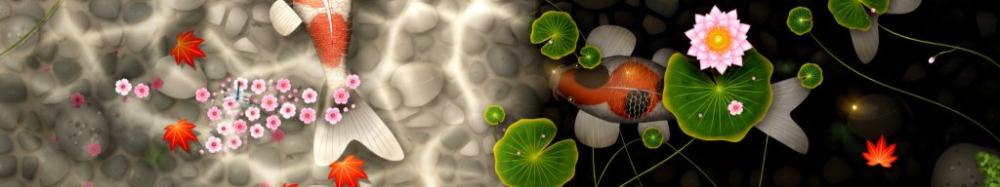

<p align="center">
  
</p>

# Saayan Chowdhury | Dual Koi Portfolio

> 🌐 **Live Demo:** [https://dual-koi-portfolio.vercel.app/](https://dual-koi-portfolio.vercel.app/)

An interactive, canvas-driven dual portfolio. It blends traditional Japanese art aesthetics—**Mokkotsu** (boneless watercolor) and **Sumi-e** (ink wash)—with real-time fish flocking physics and interactive fluid dynamics.

---

## Features

- **Autonomous Koi Simulation**: Real-time fish flocking physics, collision avoidance, spine curvature geometry, and ripple wave propagation.
- **Dual Visual Styles**:
  - **Mokkotsu**: Rich, full-color watercolor presentation.
  - **Sumi-e**: High-contrast, minimalist Japanese Zen ink wash styling.
- **Navier–Stokes Fluid Mask Engine**: Real-time fluid advection and diffusion simulating spilled liquid ink that bleeds across the screen to transition between visual styles.
- **4-Column Brocade Portfolio UI**: Imperial crimson brocade cards that unfold into vertical floral scroll paintings with custom typography (`KanjiBrutalist`).
- **Dynamic Age Telemetry**: Live counter accurately computing exact elapsed years, months, days, hours, minutes, and seconds based on local time.
- **Day & Night Synchronization**: Automatically matches the pond illumination to your local clock, featuring an interactive lantern flashlight in night mode.
- **Zero Runtime Dependencies**: Built with pure TypeScript, WebGL/WebGL2, and HTML5 Canvas.

---

## Interactive Controls & Features

### 1. Pond & Water Surface
* **Disturbing Water & Guiding Koi**: Moving your pointer across the pond leaves subtle wake ripples that fish steer around or follow.
* **Splashing & Scaring Koi**: Clicking anywhere on open water produces a dynamic splash ripple that scatters nearby fish.

---

### 2. Top-Right Floating Controls
* **Oni Mask Button (`Portfolio Reveal`)**:
  * Toggles the 4-column portfolio overlay open and closed with a wave ripple effect across the pond.
* **Sun / Moon Button (`Lighting Mode`)**:
  * Toggles between bright daylight and moonlit night mode.
  * When untouched, lighting automatically synchronizes with your local system clock (day vs. evening).
* **Lantern Button (`Dark Mode Flashlight`)**:
  * Appears exclusively during Night Mode.
  * Toggles an interactive illuminated spotlight beam that follows your pointer through the darkness. When idle, the lantern drifts in a gentle, ambient path.

---

### 3. Portfolio Columns & Navigation
When the portfolio is opened, four crimson brocade columns appear.

* **Expanding a Folio**: Click on any column to expand it into an accordion view. The selected column expands into an illustrated floral scroll while shrinking the others:
  * **Folio 01 — Subject & Provenance**: Personal biography, dynamic live age breakdown, and direct contact channels.
  * **Folio 02 — Education & Journey**: Academic background, coursework, and milestones.
  * **Folio 03 — Capabilities & Arsenal**: Categorized technical skills, tools, and methodologies.
  * **Folio 04 — Works & Projects**: Interactive project catalog. Click any project entry to expand its detailed description and links.
* **Collapsing a Folio**: Click the currently expanded column or click outside to return to the balanced multi-column view.

---

### 4. Portrait Frame
* **Toggling Photo / Illustration**: In the left pane of Folio 01, click directly on the circular portrait frame to toggle between the stylized Oni mask illustration and Saayan's photograph.

---

### 5. Fluid Ink Style Transition (Mokkotsu ↔ Sumi-e)
You can transition the visual presentation between watercolor and ink wash at any time using gesture-based fluid dynamics:

* **Click & Drag / Swipe**: Press and drag across the screen to inject turbulent liquid ink onto the canvas.
* **Style Swap Threshold**:
  * **Drag past ~60% screen coverage**: The liquid ink floods the entire viewport and seamlessly flips the active style (Mokkotsu to Sumi-e or vice-versa).
  * **Release before 60%**: The fluid ink naturally retracts and dissolves back into the water.

---

## Project Structure

```
├── src/
│   ├── koi/
│   │   ├── caudalFin.ts          # Anatomical caudal fin geometry & 12-ray spline solver
│   │   ├── engine.ts             # Core Koi pond loop and UI control orchestration
│   │   ├── koiGeometry.ts        # Spine kinematics, fin anchors, and fish outline curves
│   │   ├── koiRenderer.ts        # Canvas-based fish body and pond surface renderer
│   │   ├── koiSimulation.ts      # Multi-agent fish boid physics, steering, and geometry
│   │   ├── koiTypes.ts           # Type definitions for Koi anatomy and physics state
│   │   ├── koiVarieties.ts       # Color varieties (Kohaku, Taisho Sanke, Showa, etc.)
│   │   ├── pondWorld.ts          # Boundary simulation and obstacle avoidance
│   │   ├── portfolioColumns.ts   # 4-column brocade and floral accordion UI
│   │   ├── portfolioData.ts      # Profile bio, dynamic age calculator, and projects
│   │   ├── rippleField.ts        # 2D discrete wave ripple grid
│   │   └── columnArtData.ts      # Embedded artwork textures and base64 assets
│   ├── fluidMaskEngine.ts        # WebGL Navier-Stokes fluid advection and layer mask
│   ├── koiFluidApp.ts            # Dual-layer manager binding Mokkotsu and Sumi-e engines
│   ├── kanjiFontData.ts          # Custom font definitions
│   └── sharedState.ts            # State synchronization between visual layers
├── demo.ts                       # Application mount entrypoint
├── index.html                    # Root HTML document
└── vite.config.ts                # Bundler configuration
```

---

## Getting Started

### Prerequisites
- Node.js (v18 or higher recommended)
- npm or pnpm

### Installation

```bash
# Clone the repository
git clone https://github.com/Saayan-Chowdhury-2004/Dual_KOI_Portfolio.git

# Navigate into the project directory
cd Dual_KOI_Portfolio

# Install dependencies
npm install
```

### Development Server

```bash
npm run dev
```

Visit the local URL shown in your terminal (usually `http://localhost:5173`) to view the portfolio.

### Production Build

```bash
npm run build
```

Build outputs are generated in the `dist/` directory.

---

## License

Private / All Rights Reserved © Saayan Chowdhury.
